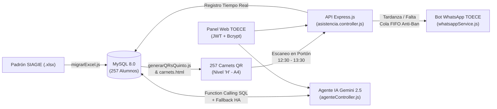

# Informe Técnico de Ingeniería y Despliegue en Producción

**Proyecto:** Diseño de un sistema automatizado para la gestión de asistencia estudiantil mediante código QR en la **I.E. Nuestra Señora de las Mercedes** (Paita - Perú)  
**Desarrollador:** Dayron Iván Talledo Rojas  
**Alcance del Piloto:** 5to Grado de Nivel Secundaria — Turno Tarde (257 estudiantes activos, Secciones A – H)  
**Arquitectura:** API REST Modular (MVC) en Node.js + Express.js, MySQL 8.0, Bot WhatsApp (`whatsapp-web.js` + `LocalAuth`), Inteligencia Artificial (`@google/genai` Gemini 2.5 Flash) e Infraestructura Cloud en **AWS EC2 (Ubuntu 24.04 LTS)**.

---

## 1. Resumen Ejecutivo de Módulos Completados

---

## 2. Detalle Cronológico de Tareas Realizadas y Soluciones Técnicas

### FASE 0: Auditoría de Datos y Migración SIAGIE a MySQL
1. **Resolución de rutas y variables de entorno (`backend/src/config/db.js`):**
   - Se blindó la carga del archivo `.env` mediante rutas absolutas (`path.resolve(__dirname, '../../.env')`) para garantizar la conexión al pool de MySQL sin importar el directorio desde donde se invoque el script.
2. **Inspección del XML interno de SIAGIE (`backend/ListadoEstudiantes.xlsx`) y corrección de `backend/src/scripts/migrarExcel.js`:**
   - **Problema detectado:** El archivo oficial de SIAGIE utiliza celdas combinadas y las columnas tenían un desplazamiento de `+1` respecto a los índices en base 0 de JavaScript, provocando que el script leyera celdas vacías y reportara `0 alumnos válidos`.
   - **Solución:** Se recalibró el inicio de lectura a la fila 3 (`filas.slice(2)`) y se mapearon los índices exactos en base 0:
     - `fila[1]` (Columna B): Grado (`QUINTO`)
     - `fila[2]` (Columna C): Sección (`A` hasta `H`)
     - `fila[7]` (Columna H): DNI (validado con expresión regular `/^\d{8}$/`)
     - `fila[12]` (Columna M): Apellido Paterno
     - `fila[16]` (Columna Q): Apellido Materno
     - `fila[19]` (Columna T): Nombres
     - `fila[25]` (Columna Z): Estado de Matrícula (`DEFINITIVA`)
   - **Resultado en producción:** **257 estudiantes activos de 5to de Secundaria migrados** mediante *Bulk Upsert* (`INSERT ... ON DUPLICATE KEY UPDATE`) y **2 estudiantes omitidos** automáticamente por condición de `TRASLADADO`.

---

### FASE 1: Generación Masiva de Códigos QR y Maquetación de Carnets Institucionales
3. **Generación de QRs por Sección (`backend/src/scripts/generarQRsQuinto.js`):**
   - Extracción desde MySQL ordenada por sección y apellidos.
   - Creación automática de subdirectorios `qrs_impresion/5to_Secundaria/Seccion_A` hasta `Seccion_H`.
   - Exportación de los **257 archivos `.png`** en resolución de `400px` con **Nivel de Corrección de Errores `'H'` (High)**, capaz de soportar hasta un 30% de desgaste físico o manchas en el carnet impreso.
4. **Diseñador y Generador de Carnets en Formato A4 (`frontend/carnets.html`):**
   - Desarrollo de un módulo web de impresión masiva en medidas estándar **CR80 vertical (`60mm × 90mm`)** que distribuye **9 carnets por hoja A4 (3×3)** con saltos de página exactos (`page-break-inside: avoid`).
   - Integración de la **Insignia Oficial de la I.E. Nuestra Señora de las Mercedes**, colores institucionales (Guinda/Carmesí y Dorado), código QR nivel `'H'`, apellidos, nombres, grado, sección y DNI.
   - Filtros dinámicos para imprimir todo el padrón (29 hojas A4), una sección específica o el carnet individual de un alumno.

---

### FASE 2: Reglas Horarias de Asistencia (Turno Tarde) y Cierre Automático de Portón
5. **Parametrización del Horario Oficial del Turno Tarde (`backend/src/controllers/asistencia.controller.js`):**
   - Sincronización determinista de fecha y hora en zona horaria **`America/Lima`** (`Intl.DateTimeFormat('sv-SE')`).
   - **12:30:00 a 12:45:00 hrs:** Registro clasificado como **`Puntual`**.
   - **12:45:01 a 13:30:00 hrs:** Registro clasificado como **`Tardanza`** + disparo desacoplado (*Fire-and-Forget* con `setImmediate`) de alerta de WhatsApp al apoderado para responder al escáner del portón en `<50ms`.
   - **Control de Doble Escaneo:** Captura atómica del error `ER_DUP_ENTRY` (`409 Conflict`) gracias al índice único compuesto `UNIQUE KEY (estudiante_id, fecha)`.
6. **Módulo de Cierre de Portón a las `13:30:00` (Generación de Faltas):**
   - **Cierre Automático (`iniciarProgramadorCierrePorton`):** Proceso en segundo plano que verifica el reloj de Perú de lunes a viernes y, al marcar las `13:30`, identifica mediante `LEFT JOIN` a todos los alumnos de 5to sin marcación en el día, les inserta el estado **`Falta`** masivamente y encola las notificaciones de WhatsApp a sus apoderados.
   - **Cierre Manual (`POST /api/asistencia/cerrar-porton`):** Endpoint protegido para que el auxiliar de TOECE pueda ejecutar o adelantar el cierre desde el panel web.

---

### FASE 3: Servicio de Alertas por WhatsApp con Cola Anti-Bloqueo (Queue)
7. **Implementación de `backend/src/utils/whatsappService.js`:**
   - **Persistencia `LocalAuth`:** Almacenamiento de sesión en `.wwebjs_auth` (`clientId: 'bot-toece-mercedes'`) para evitar re-escanear el QR en cada reinicio.
   - **Normalización Telefónica Peruana:** Formateo automático de números de 9 dígitos (`9XXXXXXXX` -> `519XXXXXXXX`) y validación previa de existencia de cuenta en WhatsApp mediante `client.getNumberId()`.
   - **Cola FIFO con *Jitter* Anti-Spam (`procesarCola`):** Despacho secuencial con pausas aleatorias de **3.5 a 6.5 segundos** entre cada mensaje para proteger la línea institucional de bloqueos en Meta durante las horas punta en el portón.
   - **Resiliencia en Cloud (AWS EC2):**
     - Limpieza automática de candados huérfanos de Chromium (`SingletonLock`, `SingletonCookie`, `SingletonSocket`) al iniciar el servidor.
     - Ampliación de `protocolTimeout: 180000` (3 minutos) y desactivación de `sendSeen` para evitar errores de *detached Frame* o *Runtime.callFunctionOn timed out* en contenedores Linux.
     - Renderizado del QR de vinculación directamente en el Panel Web de TOECE (`QRCode.toDataURL`) además de la terminal.

---

### FASE 4: Seguridad Backend (Autenticación JWT y Encriptación Bcrypt)
8. **Controlador de Login y Middleware Protector (`backend/src/controllers/auth.controller.js` y `backend/src/middlewares/auth.middleware.js`):**
   - Verificación de credenciales contra la tabla `usuario` (`id_usuario`, `username`, `password`, `rol`) usando `bcrypt.compare()`.
   - Emisión de tokens **JWT (`jsonwebtoken`)** firmados con `JWT_SECRET` y tiempo de expiración de `8h` (jornada laboral).
   - Protección mediante middleware `verificarToken` (`Bearer <token>`) en todas las rutas administrativas de TOECE (`/api/chat`, `/api/asistencia/resumen`, `/api/asistencia/cerrar-porton`, `/api/estudiantes`).
9. **Script Semilla de Usuario Administrador (`backend/src/scripts/crearAdminTOECE.js`):**
   - Creación automatizada del usuario `admin_toece` con contraseña hasheada con 10 rondas de *salt* en Bcrypt y detección dinámica de tipos `ENUM` en la columna `rol`.

---

### FASE 5: Agente Analítico de Inteligencia Artificial (Gemini 2.5 Flash + Alta Disponibilidad)
10. **Ampliación de Herramientas SQL (`backend/src/utils/iaSkills.js` y `backend/src/controllers/agenteController.js`):**
    - **`consultar_tardanzas`:** Permite filtrar nominalmente por grado, sección (`A`–`H`), fecha (`YYYY-MM-DD`) y estado específico (`Tardanza`, `Falta` o `Puntual`).
    - **`obtener_estadisticas_asistencia`:** Calcula en una sola consulta `GROUP BY e.seccion` los totales de padrón, puntuales, tardanzas, faltas y pendientes de las 8 secciones de 5to.
    - **Comprensión de Fechas Relativas:** Traducción automática de expresiones en lenguaje natural (*"hoy"*, *"ayer"*, *"anteayer"*, `DD/MM/YYYY`) a formato ISO `YYYY-MM-DD` en zona horaria de Perú, sincronizada además con el selector de fecha del Dashboard.
    - **Motor SQL de Alta Disponibilidad (Fallback):** Si ocurre una caída de internet o límite de cuota en la API externa, el controlador resuelve la consulta en lenguaje natural ejecutando las Skills SQL directamente sobre MySQL sin interrumpir el servicio de TOECE.

---

### FASE 6: Frontend Web Institucional (Kiosco Portón + Panel TOECE)
11. **Construcción de la Interfaz Web (`frontend/index.html`):**
    - **Identidad Visual Mercedaria:** Incorporación de la insignia oficial (`frontend/INSIGNIA mercedes png.png`) y paleta institucional (Rojo Carmesí `#c8102e`, Guinda `#7f091c` y Dorado `#facc15`).
    - **Vista 1 — Kiosco de Escaneo QR en Portón:**
      - Soporte dual: **Pistola lectora láser USB** (foco automático) y **Cámara Web / Celular** (`html5-qrcode`).
      - Tarjeta semáforo en tiempo real (Verde = Puntual, Ámbar = Tardanza, Rojo = Doble escaneo o DNI no válido) con alerta sonora sintetizada por *Web Audio API* y listado de últimas lecturas.
    - **Vista 2 — Panel Administrativo TOECE (Protegido con Login JWT):**
      - Tarjetas KPI en vivo (Padrón `257`, Puntuales, Tardanzas, Faltas, Pendientes).
      - Tabla de asistencia filtrable por fecha y sección (`5to A` – `5to H`).
      - Módulo de **Gestión de Celulares de Apoderados** con búsqueda instantánea por DNI/apellidos y guardado en 1 clic (`PUT /api/estudiantes/:dni/telefono`).
      - Panel de estado y vinculación QR de WhatsApp integrado en la web.
      - Ventana lateral interactiva del **Asistente Analítico TOECE (IA)** con chips de consulta rápida.

---

### FASE 7: Despliegue en la Nube en AWS EC2 (Ubuntu 24.04 LTS)
12. **Infraestructura y Aprovisionamiento Cloud (`deploy/setup-ubuntu-ec2.sh`, `deploy/schema.sql` y `backend/ecosystem.config.js`):**
    - Despliegue en instancia **AWS EC2 `t3.small`** con **Ubuntu Server 24.04 LTS**.
    - Configuración de **2 GB de memoria SWAP**, zona horaria `America/Lima`, **MySQL 8.0**, **Node.js 20 LTS**, **Nginx Reverse Proxy** (Puerto 80 -> 3000) y librerías nativas de Linux para **Google Chrome Headless (`146.0.7680.31`)**.
    - Gestión de procesos en segundo plano 24/7 con **PM2** (`asistencia-mercedes`) y exposición segura con certificado SSL mediante **Cloudflare Tunnel (`HTTPS`)** para habilitar el acceso a la cámara web en smartphones desde cualquier red móvil.

---

## 3. Resumen de Archivos Clave del Proyecto

| Capa | Archivo | Función Principal |
| :--- | :--- | :--- |
| **Configuración** | `backend/src/config/db.js` | Pool de conexiones MySQL con `enableKeepAlive` y `dateStrings` |
| **Migración / QRs** | `backend/src/scripts/migrarExcel.js` | ETL del Excel SIAGIE (257 alumnos activos de 5to) |
| **Migración / QRs** | `backend/src/scripts/generarQRsQuinto.js` | Generador masivo de QRs `.png` Nivel `'H'` por sección |
| **Seguridad** | `backend/src/controllers/auth.controller.js` | Login con Bcrypt y emisión de token JWT (`8h`) |
| **Seguridad** | `backend/src/middlewares/auth.middleware.js` | Middleware `verificarToken` y control de roles RBAC |
| **Core Negocio** | `backend/src/controllers/asistencia.controller.js` | Escaneo QR, horario Turno Tarde, cierre 13:30 y métricas |
| **Mensajería** | `backend/src/utils/whatsappService.js` | Bot WhatsApp con `LocalAuth`, QR web y cola FIFO Anti-Ban |
| **Módulo IA** | `backend/src/controllers/agenteController.js` | Orquestador Gemini 2.5 Flash + Fallback SQL de alta disponibilidad |
| **Módulo IA** | `backend/src/utils/iaSkills.js` | Skills parametrizadas `consultar_tardanzas` y `obtener_estadisticas_asistencia` |
| **Frontend** | `frontend/index.html` | Kiosco de Portón QR + Login + Dashboard TOECE + Chat IA |
| **Frontend** | `frontend/carnets.html` | Generador de los 257 carnets estudiantiles en hojas A4 (PDF) |
| **Cloud / DevOps** | `deploy/setup-ubuntu-ec2.sh` | Script de aprovisionamiento automático en AWS EC2 Ubuntu 24.04 |
| **Cloud / DevOps** | `deploy/schema.sql` | Estructura DDL de tablas `Estudiante`, `Asistencia` y `usuario` |
| **Cloud / DevOps** | `backend/ecosystem.config.js` | Configuración de ejecución continua con PM2 |
